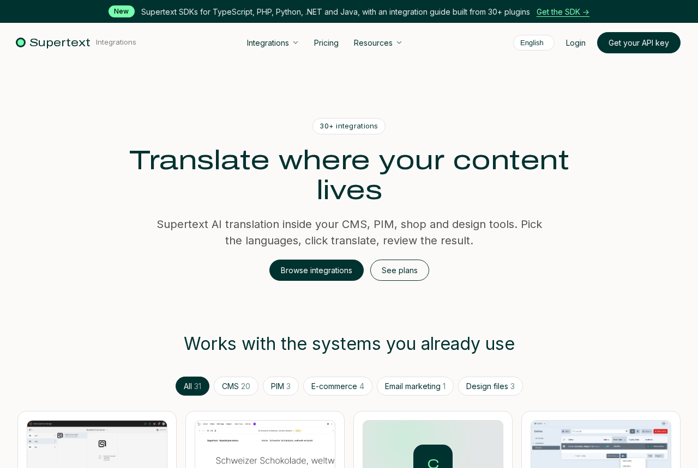

# Supertext integrations site

The website that presents all Supertext integrations (CMS, PIM, e-commerce, email marketing and design files) and sells support and localization subscriptions for them.

- **`cms/`**: Strapi 5. Editors build pages from reusable blocks, see a live preview next to the editor and translate content into German, French and Italian with the Supertext plugin. The CMS also creates Stripe Checkout sessions and records subscriptions.
- **`web/`**: Next.js website in the style of supertext.com. It reads content from Strapi.

Both run on Railway. Each integration's latest version comes from GitHub every night.

## Guides

- [Installation and operation](docs/INSTALLATION.md): Railway services, variables, Stripe, Supertext API key, troubleshooting
- [User guide](docs/USER_GUIDE.md): editing pages and integrations, blocks, preview, translation, plans and subscriptions
- [Developer guide](docs/DEVELOPER.md): architecture, content model, local setup, shop flow, CI

No Supertext account yet? [Create one at supertext.com](https://www.supertext.com/person/en/account/signin). Generate your API key at [supertext.com → Integrations → API](https://www.supertext.com/en/integrations/api) (requires the Admin role).

## License

The code is [MIT licensed](LICENSE). The Supertext name and logo and the site's content (texts, images, prices) are not covered by the license: © Supertext AG, all rights reserved.

## Security

See [SECURITY.md](SECURITY.md).
