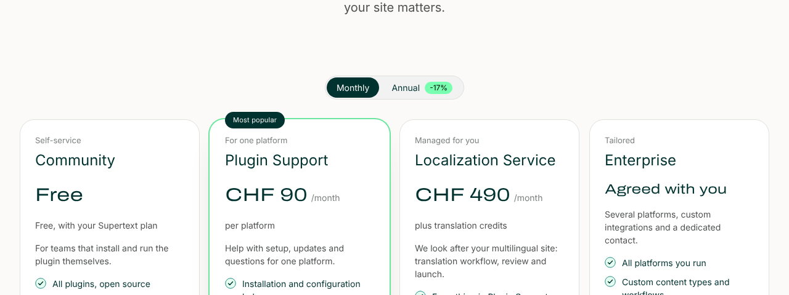

# Installation and operation

The site runs in its own Railway project, **supertext-integrations-site** (not with the CMS demos): two services built from this repository and a Postgres service. Everything runs in the `ams` region.

| Service | Railway domain |
| --- | --- |
| `cms` | https://cms-production-ce14.up.railway.app (admin at `/admin`) |
| `web` | https://web-production-0657be.up.railway.app |

| Service | Dockerfile | Port | Health check |
| --- | --- | --- | --- |
| `cms` (Strapi 5) | `cms/Dockerfile` | 1337 | `/health` |
| `web` (Next.js) | `web/Dockerfile` | 3000 | `/health` |

Both Dockerfiles use the **repository root** as build context. Railway ignores `railway.json`, so set the Dockerfile path (`RAILWAY_DOCKERFILE_PATH`), health check (`/health`; 600 s on `cms`, whose first start runs Strapi's migrations) and restart policy on each service. Deploy in the `ams` region (a service created through the API may land in the US; check its region).

## Requirements

- Node.js 22 (in the images)
- PostgreSQL: the project's own Postgres service. The CMS creates its database on start (`INTEGRATIONS_DB_NAME`).
- A volume on `cms` at `/app/public/uploads` for uploaded images
- A Stripe account for the shop
- A Supertext API key for translating the content

## Variables

Generate each secret with `openssl rand -base64 32`. Never commit values; they live only in Railway.

### `cms`

| Variable | Purpose |
| --- | --- |
| `PORT` | `1337` (Railway's domain points at this port; without it Railway injects its own and the site returns 502) |
| `DATABASE_URL` | Connection string of the Postgres service (`${{Postgres.DATABASE_URL}}`) |
| `INTEGRATIONS_DB_NAME` | This site's database on that server, e.g. `integrations_site`. Created on start if it doesn't exist. |
| `URL` | Public URL of the CMS, e.g. `https://cms-integrations.up.railway.app` |
| `APP_KEYS`, `API_TOKEN_SALT`, `ADMIN_JWT_SECRET`, `TRANSFER_TOKEN_SALT`, `JWT_SECRET`, `ENCRYPTION_KEY` | Strapi secrets (`APP_KEYS` is a comma-separated list of two or more) |
| `CLIENT_URL` | Public URL of the website. The preview pane and CORS allow only this origin. |
| `PREVIEW_SECRET` | Shared with `web`; turns on the preview pane |
| `STRAPI_API_TOKEN` | Shared with `web`. On every start it becomes the key of the read-only API token "web". |
| `DEMO_ADMIN_EMAIL`, `DEMO_ADMIN_PASSWORD` | Super Admin, created on start if it doesn't exist |
| `DEMO_EDITOR_EMAIL`, `DEMO_EDITOR_PASSWORD` | Editor with access to all four languages, created on start if it doesn't exist |
| `SUPERTEXT_API_KEY` | Supertext API key for the Translate panel (see below) |
| `AUTO_TRANSLATE` | Optional: `false` stops the first automatic translation of all content into German, French and Italian (see below) |
| `STRIPE_SECRET_KEY` | Stripe secret key (`sk_live_…`, or `sk_test_…` for testing) |
| `STRIPE_WEBHOOK_SECRET` | Signing secret of the Stripe webhook endpoint (`whsec_…`) |
| `STRIPE_AUTOMATIC_TAX` | `true` to let Stripe Tax add Swiss VAT (Stripe Tax must be set up in Stripe) |
| `GITHUB_TOKEN` | Optional: read-only token for the nightly release sync (raises GitHub's rate limit) |
| `PLUGIN_REF` | Optional build argument: branch or tag of the Supertext Strapi plugin (default `main`) |

Account passwords need 8+ characters with an upper-case letter, a lower-case letter and a number. A weaker password skips that account with a warning; the CMS still starts. Existing accounts are never changed. Once `DEMO_ADMIN_*` is set, Strapi's "create the first administrator" screen no longer appears.

### `web`

| Variable | Purpose |
| --- | --- |
| `PORT` | `3000` |
| `STRAPI_URL` | CMS address for server requests, e.g. `http://cms.railway.internal:1337` |
| `STRAPI_PUBLIC_URL` | Public URL of the CMS (images, preview). **Also a build argument**: set it before the first build. |
| `STRAPI_API_TOKEN` | Same value as on `cms` (`${{cms.STRAPI_API_TOKEN}}`) |
| `PREVIEW_SECRET` | Same value as on `cms` (`${{cms.PREVIEW_SECRET}}`) |
| `REVALIDATE_SECRET` | Secret of the Strapi webhook that refreshes the cache |
| `SITE_URL` | Public URL of the website (canonical links, sitemap, structured data) |
| `ALLOW_INDEXING` | `true` lets search engines and AI crawlers index the site (robots.txt, `noindex` tags). Leave unset until the site runs on its real domain with final prices. |
| `STRIPE_PORTAL_URL` | Optional: Stripe customer portal login link, shown after checkout |

## First deployment

1. Create the `cms` service from this repo, add the uploads volume, set its variables and deploy. On the first start it creates the accounts, the languages (German, French, Italian), the read token and the starter content: all integrations, example plans, the start, integrations and pricing pages, and the header and footer.
2. Create the `web` service, set its variables (including `STRAPI_PUBLIC_URL` before building) and deploy.
3. Set `CLIENT_URL` on `cms` to the website's URL and redeploy `cms`.
4. In Strapi → *Settings → Webhooks*, add a webhook to `https://<web>/api/revalidate` with the header `Authorization: Bearer <REVALIDATE_SECRET>` and the events *Entry publish*, *unpublish*, *update* and *delete*. Without it, published changes appear within a minute.

## Supertext API key

No Supertext account yet? Create one at [supertext.com](https://www.supertext.com/person/en/account/signin). Generate your API key at [supertext.com → Integrations → API](https://www.supertext.com/en/integrations/api) (requires the Admin role). Set it as `SUPERTEXT_API_KEY` on `cms`. Until then, the edit view shows "Supertext is not configured yet".

With the key set, the CMS translates all content into German, French and Italian once, in the background after start-up (takes some minutes; uses Supertext credit), and publishes the language versions. Published translations made by editors are left alone. Review the results in the admin; later changes are translated with the panel as usual. Set `AUTO_TRANSLATE=false` to skip this.

Translations go out as Swiss German, French and Italian (`de-CH`, `fr-CH`, `it-CH`) in formal address; the site's own language codes stay `de`, `fr`, `it`. Supertext rejects plain `de`/`fr`/`it` as a target ("INVALID_LANGUAGE_PAIR"). To change the variety, edit `locales` in `cms/config/plugins.js`.

The plugin isn't on npm: the Docker build clones [Strapi-Supertext-Translation](https://github.com/Supertext/Strapi-Supertext-Translation), builds it and installs it (`cms/scripts/fetch-plugin.sh`). To pin a version, set the build argument `PLUGIN_REF` to its tag.

## Stripe

1. In Stripe, create one product per plan with a monthly and an annual recurring price in CHF. The annual price is the full year's amount.
2. In Strapi, open the plan under *Service plan* and enter the price IDs (`price_…`) in *stripePriceMonthly* and *stripePriceAnnual*. A plan without a price ID shows "Online checkout for this plan opens soon".
3. Add a webhook endpoint `https://<cms>/api/shop/webhook` with the events `checkout.session.completed`, `customer.subscription.created`, `customer.subscription.updated` and `customer.subscription.deleted`. Put its signing secret in `STRIPE_WEBHOOK_SECRET`.
4. Optional: activate the customer portal and its login link (Stripe → *Settings → Billing → Customer portal*) and put the link in `STRIPE_PORTAL_URL` on `web`.
5. Optional: set up Stripe Tax for Switzerland and set `STRIPE_AUTOMATIC_TAX=true`.

Test with test keys first: card `4242 4242 4242 4242`, any future date, any CVC.

## Search engines and AI assistants

- `robots.txt`, `sitemap.xml` (every page and integration in each translated language, with hreflang) and `llms.txt` (a plain-text summary for AI assistants, built from the CMS) are generated on request.
- While `ALLOW_INDEXING` isn't `true`, robots.txt blocks everything and every page carries `noindex`. When you switch it on, AI crawlers (GPTBot, ClaudeBot, PerplexityBot, Google-Extended …) are allowed explicitly.
- After launching on the real domain: set `SITE_URL` and `ALLOW_INDEXING=true` on `web`, then submit `https://<domain>/sitemap.xml` in Google Search Console and Bing Webmaster Tools.

## Updating

Pushes to `main` redeploy both services on Railway. If a push doesn't deploy, check that Railway's GitHub app has access to this repo (https://github.com/organizations/Supertext/settings/installations → Railway → Configure), then reconnect each service's source once. Strapi applies content-model changes when it starts. Back up the database before changing or removing fields that hold content.

## Troubleshooting

| Symptom | Cause and fix |
| --- | --- |
| Website shows errors or empty pages | `STRAPI_API_TOKEN` differs between the services, or `STRAPI_URL` is wrong. The CMS log says `[setup] STRAPI_API_TOKEN is not set` when it is missing. |
| Preview pane stays blank | `CLIENT_URL` (cms), `STRAPI_PUBLIC_URL` (web, at build time) or `PREVIEW_SECRET` don't match. Rebuild `web` after changing `STRAPI_PUBLIC_URL`. On different domains the browser may block the preview cookie; use subdomains of one domain (e.g. `cms.` and `integrations.supertext.com`). |
| "Checkout is not available right now" | `STRIPE_SECRET_KEY` is missing or wrong, or the price ID doesn't exist in that Stripe mode (test vs. live). See the CMS log (`[shop]`). |
| Subscriptions don't appear in Strapi | The Stripe webhook URL or `STRIPE_WEBHOOK_SECRET` is wrong. Stripe → *Webhooks* shows the failed deliveries. |
| No version numbers on the integration pages | The nightly sync couldn't reach GitHub (rate limit). Set `GITHUB_TOKEN`. See the log (`[github]`). |
| "Error loading the plugin supertext" | The plugin isn't in `package.json`: run `npm run plugin` in `cms/`. |
