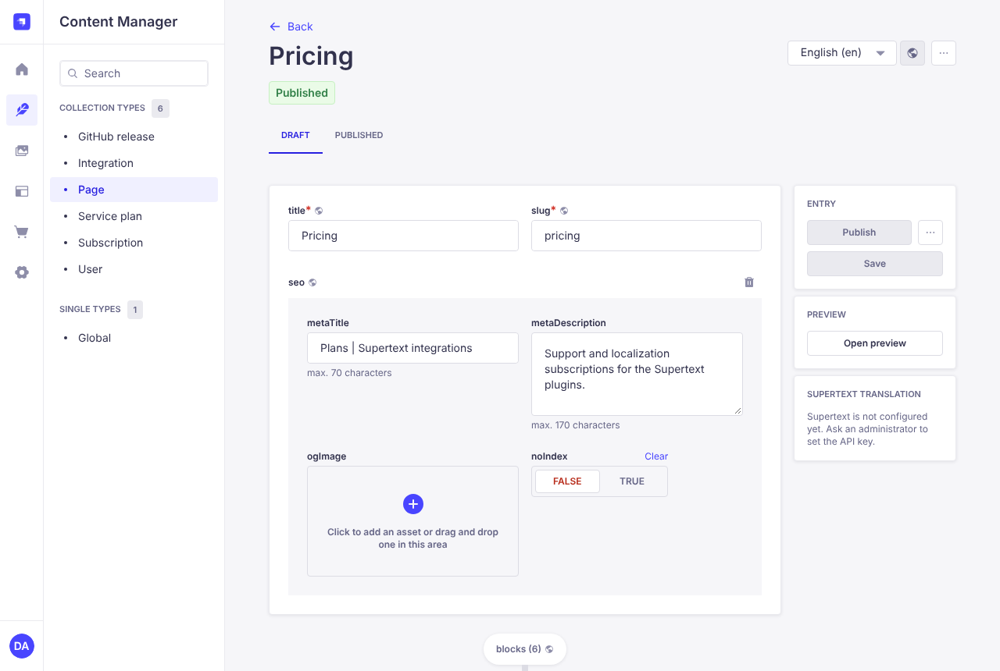
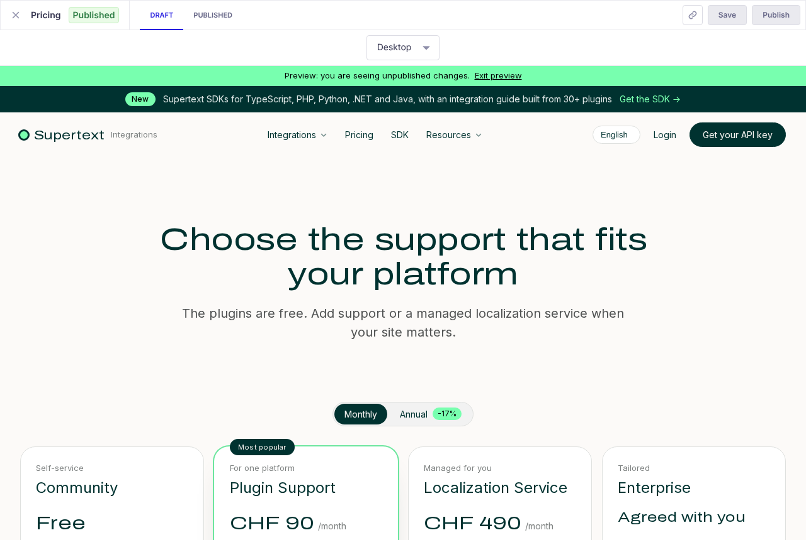
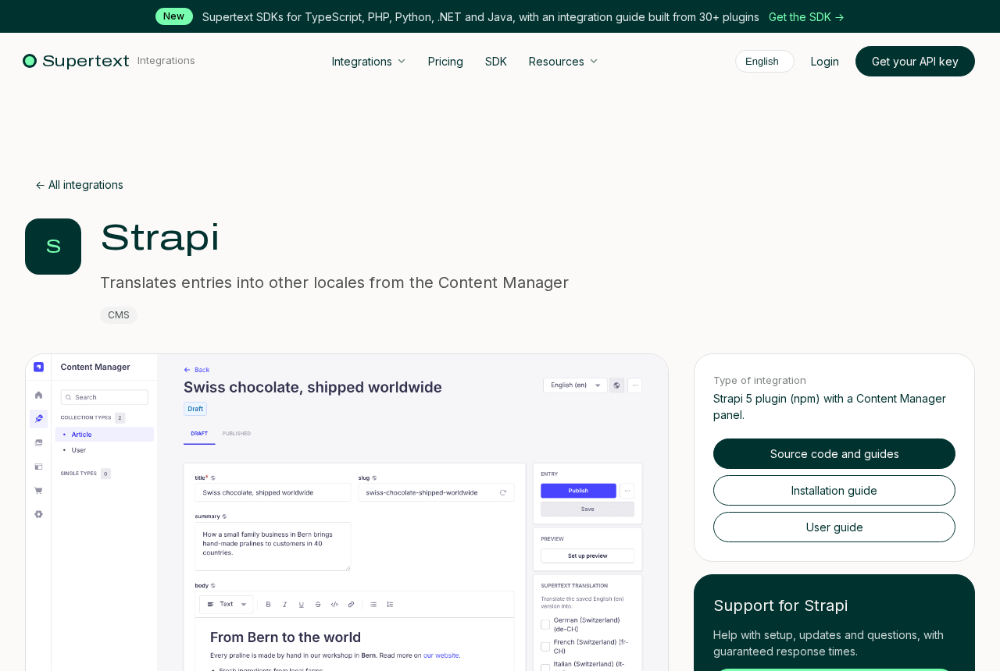

# User guide for editors

Log in to the Strapi admin at `https://<cms>/admin`. All content is under **Content Manager**.

| Content type | What it is |
| --- | --- |
| **Page** | A page of the site, built from blocks. The slug `home` is the start page; `pricing` and `integrations` are the other main pages. |
| **Integration** | One Supertext plugin: its name, category, description and GitHub repository. Each one gets its own page under `/integrations/<slug>`. |
| **Service plan** | A subscription in the shop: name, prices, features and the Stripe price IDs. |
| **Global** | Announcement bar, header menu, header buttons, footer columns and default SEO texts. |
| **GitHub release** | Filled in automatically every night. Don't edit it. |
| **Subscription** | Orders from the shop, written by Stripe. Stripe is the reference; changes here aren't sent back. |

## Building pages from blocks

A page's **blocks** field holds the sections from top to bottom. *Add a component to blocks* adds one; drag to reorder.

| Block | Use it for |
| --- | --- |
| Hero | Page title, subtitle, up to two buttons, optional image (*centered* or *split*) |
| Plan cards | Pick service plans; shows them as cards with a monthly/annual toggle and checkout |
| Feature cards | Two to four cards with title, text and optional image or link. Without images they're numbered steps. |
| Use case | A short story with line items and values, like "What that looks like in practice" |
| Comparison table | Columns (plans) and rows. In a row's *cells*, write one value per line, in the column order. |
| Integration grid | All integrations, or one category, with filter buttons |
| Logo strip | A row of logos |
| FAQ | Questions with expandable answers |
| Call to action | A coloured band with a title and buttons (*dark*, *accent* or *light*) |
| Rich text | Free text with headings, lists and links |
| Notice | A highlighted box, for example "Getting started" |

**Links:** write site links as `/en/pricing` or `/en/integrations?category=pim`. The site turns them into the reader's language automatically. Links to other websites open in a new tab.

## Preview

*Open preview* in the edit view shows the page next to the editor, with your unsaved draft. After *Save*, the preview reloads. The green bar says you're seeing unpublished changes. Visitors only see a change after *Publish*.

## Translating

The site is in English, German, French and Italian. English is the source.

1. Open the English entry and choose the target language in the language menu at the top right.
2. In the **Supertext translation** panel, translate the entry. Check the result and publish it.

The first German, French and Italian versions of all pages and integrations were made with Supertext and then rewritten by translators (Swiss spelling, formal address), and published. Review them and correct what needs it; your changes are never overwritten. When you change the English text later, translate again with the panel.

Not translated yet? Visitors see the English version of that page or integration. Names, categories, repositories, prices and Stripe IDs are shared by all languages and only edited in English.

## SDK page

The Supertext SDKs have a permanent place on the site: the page **sdk** (`/sdk`, built from blocks like any page), the **SDK** item in the main menu, the section *Your system isn’t listed?* on the start page, a link in the footer and a *Build your own integration* card at the end of every integration grid. The card's texts are part of the website (all four languages); everything else is edited in the CMS.

## Comparison page

The page **compare** (`/compare`) compares Supertext with DeepL and Google Translate: what sets Supertext apart, a side-by-side table, questions. It's linked from the footer and from every integration page. The facts are as of October 2026 (sources in the project document *comparison-research*); check them when you change the page, as DeepL and Google change quickly.

## Announcement bar

The dark bar at the very top of every page, for short-lived news like the SDK launch. Untick *enabled* once the news is old; the SDK stays on the site through the SDK page and menu. Edit it in **Global → announcement**: a short *label* ("New"), the *text* and a *link*. Untick *enabled* to hide it. It's translated like the rest of Global.

## Integrations

- *category* decides the filter button; *order* the position in the grid.
- *supportedVersions*, *technology* and *license* (shared by all languages) appear in the fact box of the integration's page; *supportedVersions* also on its card.
- *description* ("How it works"), *features* ("What Supertext does in …") and *aboutSystem* ("About …") are the sections of the integration's page, translated per language.
- *stage* `in_development` adds an "In development" label and takes the integration out of the platform list at checkout.
- *repo* is the GitHub repository (`Supertext/<name>`). It links the guides and brings in the latest version every night.
- *screenshot*: the image on the integration's card and at the top of its page: a full-screen view of the system with Supertext in it. Where a plugin's repo has no full-screen view yet, the best screenshot from its guides stands in until one exists. Integrations listed in `cms/src/seed/screenshots.js` get one automatically from their plugin's repo; replace it any time in the admin (your upload is never overwritten). Without a screenshot, the card shows the initials instead.
- *logo*: without one, the site shows the initials.
- *builtInTranslation*: the section *Compared with built-in translation*: what the system offers for translation itself and what Supertext adds (Markdown, translated per language), with a link to the comparison page.
- *blocks*: optional extra sections on the integration's page. Each integration starts with a *Questions about Supertext for …* block (requirements, what's translated, languages, cost), shown on the page and to search engines; edit or extend it freely.

## Service plans and the shop

- Prices are in CHF per month. *priceAnnual* is the monthly price when paid yearly; the toggle only appears if a plan's annual price differs.
- *highlight* adds the green frame; *badge* the label above it ("Most popular").
- *askPlatform* asks the buyer to pick a platform at checkout. *platforms* limits that list (empty = all live integrations).
- *contactOnly* shows a contact button instead of checkout (enter *contactUrl*). A price of 0 shows *Free* with a button to *contactUrl*.
- Without Stripe price IDs, the button explains that online checkout opens soon.

After paying, the customer lands on a thank-you page and the order appears under **Subscription**, with plan, platform, status and the end of the current period.
